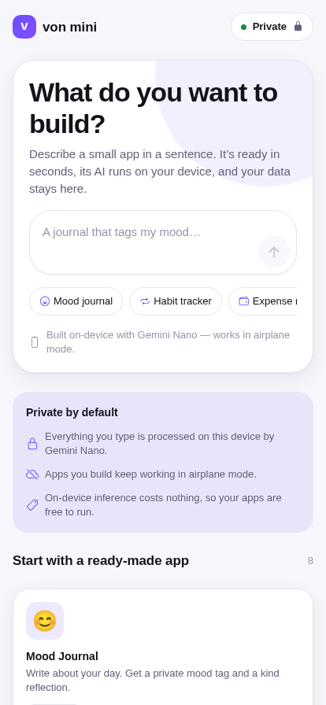
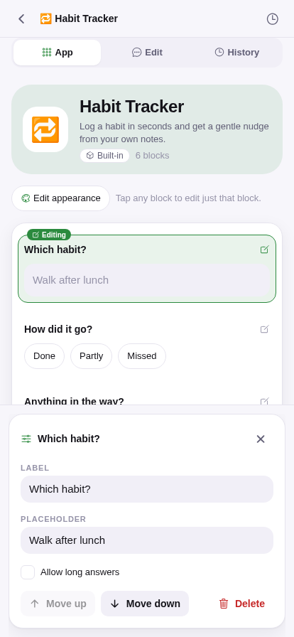
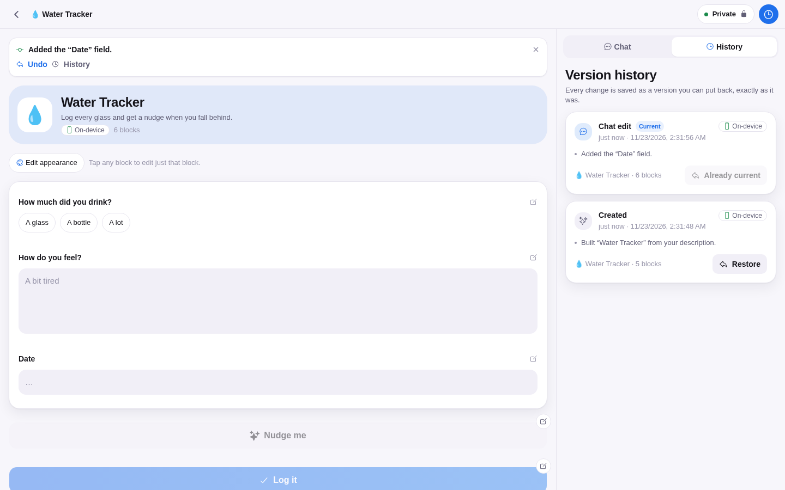
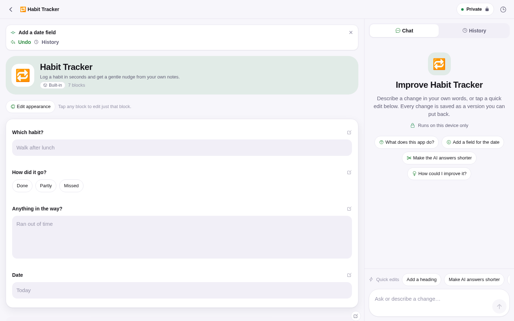
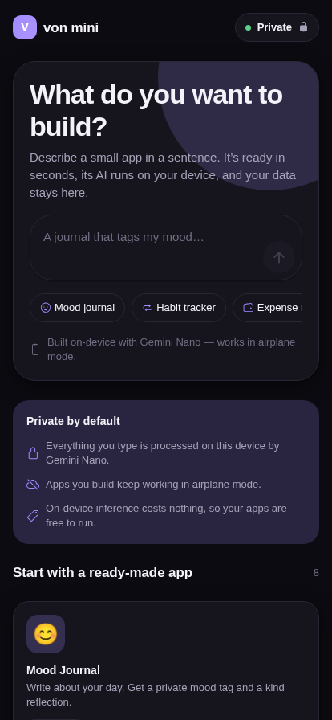
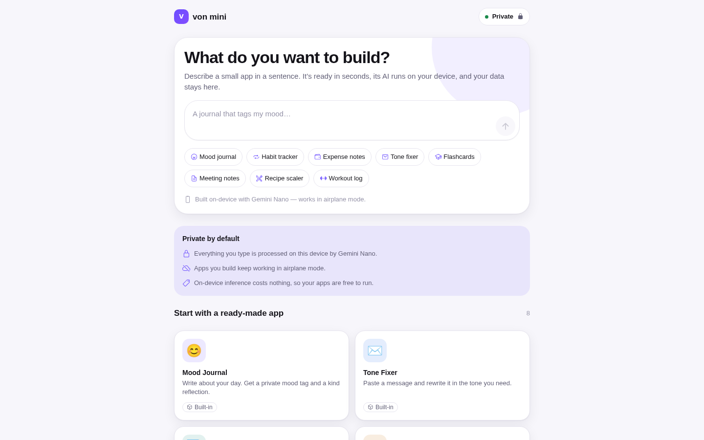

# von mini

**Build private AI apps in one sentence, on your phone, even offline.**

von mini is an app builder for Android and the web. You describe a small tool ("a journal that tags my mood", "rewrite my messages in a friendlier tone") and von mini builds a working app in seconds. The apps it builds run their AI **on your device with Gemini Nano**, keep their data **in your device's local storage**, and keep working **in airplane mode**.

It is built on **Firebase AI Logic hybrid inference**: the cloud (Gemini) is used when it adds quality, and the device (Gemini Nano) is used whenever privacy, cost, or connectivity matter.

> Submission for **#BuildHybridAI 2026**. Project text, the demo video script, judge testing
> instructions, and a rule-by-rule checklist live in [`SUBMISSION.md`](SUBMISSION.md).

| Build from one sentence | Edit any block | Every change is reversible |
|---|---|---|
|  |  |  |

| Chat edits patch the app, they don't rebuild it | Dark mode | Desktop |
|---|---|---|
|  |  |  |

## Why

Most "AI app" tools send everything you type to a server, charge per request, and stop working without a connection. That rules them out for the things people most want help with: journals, health notes, private messages, money.

von mini flips the default:

- **Private by default:** what you type into your apps is processed by Gemini Nano on the device and stored locally. A 🔒 private mode guarantees nothing is sent to the cloud.
- **Free to use:** on-device inference has no per-request cost, so the apps you build cost nothing to run.
- **Works offline:** the builder itself can build apps with Gemini Nano when there is no network.

## How it uses Firebase AI Logic

Every AI call goes through Firebase AI Logic with an explicit **inference mode**, chosen per task by a small router ([`src/ai/hybrid.ts`](src/ai/hybrid.ts)):

| Task | Online | Offline / private mode |
|---|---|---|
| Build an app | `PREFER_IN_CLOUD`: Gemini designs it, Nano as fallback | `ONLY_ON_DEVICE`: Gemini Nano designs it |
| Change an app | `PREFER_ON_DEVICE` | `ONLY_ON_DEVICE` |
| AI features inside your apps | `PREFER_ON_DEVICE` | `ONLY_ON_DEVICE` |
| "Make it custom ✨" (full HTML app) | `ONLY_IN_CLOUD` | not available |

Each response reports its `inferenceSource`, and the UI shows it with a 📱 On-device or ☁️ Cloud badge, so the hybrid behaviour is visible.

- **Android:** a local Expo native module ([`modules/nano-bridge`](modules/nano-bridge)) uses the Firebase AI Logic Android SDK (`firebase-ai` + `firebase-ai-ondevice`) with `OnDeviceConfig(InferenceMode)`. On-device requests run on Gemini Nano through AICore.
- **Web (Chrome):** [`src/ai/engine.web.ts`](src/ai/engine.web.ts) uses the Firebase JS SDK (`firebase/ai`) with `getGenerativeModel(ai, { mode, inCloudParams, onDeviceParams })`. On-device requests run on Chrome's built-in Gemini Nano.
- **App Check** protects every request: the debug provider on Android (debug tokens are accepted for the hackathon), and reCAPTCHA Enterprise or a debug token on web.

### Other Firebase products

| Product | What it does in von mini | Where |
|---|---|---|
| **Remote Config** | Tunes the product from the console without a release: the cloud model (`cloud_model`), whether new apps are designed `prefer_in_cloud` or `prefer_on_device` (`build_mode`), extra app-design rules (`spec_rules_extra`), and kill switches for voice input (`voice_input`) and sharing (`sharing`). Bundled defaults mean it behaves the same offline or before the first fetch; Settings shows whether live values are active. | Web: `firebase/remote-config`. Android: the native SDK in `modules/nano-bridge` (the JS SDK needs IndexedDB). [`src/remote/`](src/remote) |
| **Authentication** | Anonymous sign-in, only when someone shares an app, so a shared design has an owner who can update or remove it. No account, no email. | [`src/firebase/services.ts`](src/firebase/services.ts) |
| **Cloud Firestore** | Holds shared app designs (`shared/{id}`), and nothing else: entries, chats and custom HTML never leave the device. Security rules let anyone open a design by its link but nobody list them, and only the owner can change or delete one; shape and size are validated. | [`firestore.rules`](firestore.rules), [`src/share/share.ts`](src/share/share.ts) |

**Sharing an app** (⋯ → *Share this app*) publishes its design and opens the share sheet. Whoever
opens the link sees what's inside and can **Add to my apps**; the copy's AI then runs on *their*
device. Links are `https://<your web host>/s/<id>` on the web (set `EXPO_PUBLIC_SHARE_BASE_URL`
to your hosted URL so links made on phones open in any browser) or `vonmini://s/<id>` on a phone.

### Why apps are JSON, not code

Gemini Nano is small, so writing working HTML/JS is unreliable for it, but it is good at **structured output**. So von mini asks the model for an **app spec**: a short JSON description of a screen built from prebuilt blocks (inputs, choices, AI buttons, save, history). See [`src/spec/types.ts`](src/spec/types.ts). The runtime renders specs natively ([`src/runtime/SpecRenderer.tsx`](src/runtime/SpecRenderer.tsx)), and every spec is validated and repaired before it is rendered ([`src/spec/validate.ts`](src/spec/validate.ts)). This makes offline, on-device app building dependable.

When online, **"Make it custom ✨"** asks Gemini in the cloud for a fully custom single-file HTML app. It runs in a sandbox (an Android WebView or a web iframe with `sandbox="allow-scripts"`, and a Content Security Policy that blocks all network access). It can reach only a tiny `vonmini` bridge ([`src/runtime/bridge.ts`](src/runtime/bridge.ts)):

```js
await vonmini.ai('Summarize: ...')     // runs PREFER_ON_DEVICE through Firebase AI Logic
await vonmini.store.set('key', value)  // device-local storage
await vonmini.store.get('key')
await vonmini.listen()                 // speech-to-text, on-device where supported
await vonmini.speak('Hello')           // text-to-speech with the device's own voice
await vonmini.converse(persona, turns) // one spoken AI turn: Nano replies, spoken as it streams
```

So even cloud-written apps keep their AI and their data on the device.

## Voice: talk to your apps

Every app can be used by voice, and you can build and edit apps by voice. It is a **cascade** of
three on-device steps, so it keeps working in airplane mode:

1. **Speech-to-text.** The platform recognizer, asked to stay on the device: Android's
   `SpeechRecognizer` with `requiresOnDeviceRecognition` (through `expo-speech-recognition`), and
   Chrome's Web Speech API with `processLocally` where the browser supports it
   ([`src/voice/stt.ts`](src/voice/stt.ts), [`src/voice/stt.web.ts`](src/voice/stt.web.ts)).
2. **Gemini Nano** writes the reply through Firebase AI Logic (`PREFER_ON_DEVICE`, or
   `ONLY_ON_DEVICE` offline / in private mode), **streamed**
   ([`src/voice/cascade.ts`](src/voice/cascade.ts)).
3. **Text-to-speech** with the device's own voices (`expo-speech`; on the web a local voice is
   chosen explicitly). Each sentence is spoken **as soon as it is complete**, while Nano is still
   writing the rest, so a slow on-device model still answers quickly
   ([`src/voice/tts.ts`](src/voice/tts.ts)).

Where it shows up:

- **A `voice` block** in app specs: a spoken conversation with a role the app defines (e.g. *"a
  tough interviewer for a {role} job"*). Tap to talk, the AI answers out loud, hands-free mode
  listens again after each reply, and you can always type instead. The transcript is saved like
  any other field. Ask for *"an app to help me practice tough interview questions"* and you get
  one; **Interview Coach** ships ready-made.
- **A mic on every text field** of a generated app, for dictation.
- **Building and editing by voice:** the mic in the home prompt builds the app as soon as you stop
  talking, and a spoken message in the Edit chat gets a spoken reply.
- **Custom HTML apps** get `vonmini.listen / speak / converse`. The sandboxed iframe can't reach
  the microphone itself, so the host runs speech on its behalf.

If on-device recognition isn't available (older phones, or a browser without it), recognition uses
the platform's default recognizer when online, and offline the conversation falls back to typing;
replies are still spoken.

## Editing an app

Regenerating an app to change it is the wrong shape for this problem: it is slow, it loses the
entries you already saved, and it silently rearranges the layout you had learned. So a change to a
built app is a **patch against its spec**, not a new app. Three ways to make one, all of them
instant:

- **Tap a block in the preview** to select it and edit its label, placeholder, options or type in
  the docked inspector — or move and delete it ([`src/runtime/SpecEditor.tsx`](src/runtime/SpecEditor.tsx)).
- **Quick-edit chips** for the changes people ask for most: rename the app, add a field, change the
  accent, make the AI answers shorter.
- **Say it in words** — *"add a field for how much sleep I got"*. The model returns a patch to the
  spec rather than a replacement spec, so the app keeps its name, its layout and its saved data.

Deterministic edits are pure functions over the spec ([`src/spec/edit.ts`](src/spec/edit.ts)), which
is why they are instant and work with no model at all. The model is reserved for changes that are
genuinely expressed in words — and when it is used, it runs `PREFER_ON_DEVICE`, so editing works in
airplane mode.

After every change:

- a **"what changed"** summary is computed locally in plain words
  ([`src/spec/diff.ts`](src/spec/diff.ts)) and shown above the preview, with an **Undo**;
- the previous spec is snapshotted into **version history**
  ([`src/chat/HistoryPanel.tsx`](src/chat/HistoryPanel.tsx)), where any version can be restored with
  one tap. Up to 30 versions are kept per app, on the device.

## Performance

Measured on the development machine (4 vCPU, Chromium, static web export; median of warm runs).
Bundle sizes are raw / gzip-9 of the initial payload, from `npm run export:web`.

| Metric | Value |
|---|---|
| Initial bundle | 1444 KB raw / 375 KB gzip |
| Time to interactive (warm) | 165 ms |
| First contentful paint (warm) | 128 ms |
| Build flow: first pipeline step visible | 50 ms |
| Build flow: app preview visible | 147 ms |
| Preview render, 0 → 2,000 saved entries | 715 ms → 757 ms (flat) |

What the numbers are made of: routes are code-split so the builder is fetched only when opened;
list rows are memoized and the saved-entry list renders a 25-entry window, which is why render time
is flat from 0 to 2,000 entries; prompts and token budgets are kept small for Nano, with structured
output (`responseConstraint`) and a repair pass rather than retries, so a build normally costs one
round trip; the on-device model is warmed up on first interaction; and generation streams, so the
first token — and the first visible step — arrives long before the last.

`SUBMISSION.md` has the honest before/after comparison, including the one metric that got worse
(the initial bundle grew ~3% to pay for the editing layer and the design system).

## Architecture

```
┌──────────────────── von mini (Expo: Android + Web) ────────────────────┐
│ Builder ─► hybrid router ─► Firebase AI Logic                          │
│                               ├─ Android: firebase-ai + ondevice ─► Nano (AICore)
│                               ├─ Web: firebase/ai ─► Chrome built-in Nano
│                               └─ Cloud: Gemini                         │
│ App spec (JSON) ─► validated ─► native building blocks                 │
│ Custom HTML ─► sandboxed WebView/iframe ─► vonmini bridge              │
│ Storage: AsyncStorage (SQLite in Android app storage / localStorage)   │
└────────────────────────────────────────────────────────────────────────┘
```

## Setup

Requirements: Node 20+, and for Android a JDK 17+, the Android SDK, and a phone that supports Gemini Nano (for example a recent Pixel or Galaxy S) to see on-device inference. Other phones fall back to the cloud.

1. **Firebase project**
   - Create a project and enable **Firebase AI Logic** with the Gemini Developer API.
   - Add a **Web app**, then copy `.env.example` to `.env.local` and fill in its config.
   - Add an **Android app** with package `app.vonmini`, then download `google-services.json` into the repo root. It is git-ignored.
   - Enable **App Check**: reCAPTCHA Enterprise for web (put the site key in `.env.local`) and register **debug tokens** for development.
2. **Install:** `npm install`
3. **Run on web:** `npm run web` (use desktop Chrome with built-in AI enabled to get on-device Gemini Nano).
4. **Run on Android:** `npm run android` builds a development build with the native bridge. Expo Go cannot load it.
   - On first launch, the App Check debug token is printed to logcat (`DebugAppCheckProvider`). Add it in the Firebase console under App Check > Manage debug tokens.

**Sharing and Remote Config:** in the Firebase console, enable **Authentication > Anonymous**,
create a **Cloud Firestore** database, and deploy the rules: `npx firebase-tools deploy --only
firestore:rules`. Remote Config needs no setup; add any of the parameters listed above to
override their defaults. To develop against local emulators instead, run `npx firebase-tools
emulators:start --only auth,firestore` and set `EXPO_PUBLIC_FIREBASE_EMULATOR_HOST=127.0.0.1`.

**Offline mode:** set `EXPO_PUBLIC_ON_DEVICE_ONLY=true` in `.env.local` to force every AI call to run on-device (`ONLY_ON_DEVICE`). Private mode is locked on and cloud-only features are disabled. This mode needs no App Check or cloud setup — it is the fastest way to try the whole product, including building and editing apps, without a Firebase project.

**On-device model:** Settings lets you choose which Gemini Nano build the runtime loads — **Gemini Nano 4** (`nano-v4-full`), **Gemini Nano 4 Fast** (`nano-v4-fast`), or the older stable build — and reports which one actually loaded. See [`src/ai/deviceModel.ts`](src/ai/deviceModel.ts).

**Dev-only mock engine:** `EXPO_PUBLIC_MOCK_ENGINE=true` in `.env.local` runs the UI against a local canned engine that never touches the network, for developing the build/edit flows on a machine with no Gemini Nano. It is off by default and cannot run in a release build.

Useful scripts: `npm run lint`, `npm run typecheck`, `npm run export:web`, `npx expo-doctor`.

## Android builds (APK) and over-the-air updates

Builds run in the cloud on **EAS Build**, so no local Android SDK is needed, and JavaScript
changes ship to installed apps through **EAS Update** without a reinstall. Profiles live in
[`eas.json`](eas.json):

| Profile | Output | Use it for | Update channel |
|---|---|---|---|
| `development` | APK with the dev client | day-to-day development (`npx expo start`) | `development` |
| `preview` | **installable APK** | testers, judges, the demo phone | `preview` |
| `production` | Play Store app bundle (AAB) | publishing; the version code auto-increments | `production` |

**One-time setup**

1. Sign in: `npx eas-cli@latest login`
2. Link the project: `npx eas-cli@latest init`, then paste the project ID it prints into
   `EAS_PROJECT_ID` in [`app.config.ts`](app.config.ts) and commit it (it is not a secret). OTA
   updates are switched on once it is set.
3. Give EAS the Firebase config, which is git-ignored, as EAS environment variables. Do this for
   each environment you build (`development`, `preview`, `production`):
   - `npx eas-cli@latest env:create --environment preview --name GOOGLE_SERVICES_JSON --type file --value ./google-services.json --visibility secret`
   - `npx eas-cli@latest env:push --environment preview --path .env.local` (the `EXPO_PUBLIC_*` values)

**Build an APK:** `npm run build:apk`. EAS prints a link and a QR code; open it on the phone to
install. `npm run build:dev` makes a development build and `npm run build:release` a Play Store
bundle.

The Android app uses App Check's **debug provider** (debug tokens are accepted for this contest),
so each phone prints its own token to logcat on first launch (`DebugAppCheckProvider`). Add it in
the Firebase console under App Check > Manage debug tokens. On-device features (Gemini Nano,
voice) work before that; cloud calls need the token.

**Ship an update without a new APK:** after a JavaScript-only change, run
`npm run update:preview -- --message "What changed"`. Phones running the `preview` APK download
it on the next launch and apply it on the launch after, or straight away from
**Settings > App updates**. Use `npm run update:production` for Play Store builds.

The runtime version uses Expo's **fingerprint** policy, so any native change (the Kotlin bridge in
`modules/nano-bridge`, a new native library, a config plugin) produces a new runtime. Updates are
only delivered to builds with a matching runtime, so after a native change, make a new APK; an old
one will never receive JavaScript it can't run.

## Testing it

1. Open a **built-in starter app** (Mood Journal, Tone Fixer, Meeting Notes, Flashcards, Habit Tracker, Expense Notes, Recipe Scaler, Workout Log). They work immediately.
2. Type an entry and tap an ✨ AI button. The answer shows a 📱 On-device or ☁️ Cloud badge.
3. Tap **Save**. Entries are stored on the device and shown under History.
4. On the home screen, describe a new app and tap **Build**. A live panel shows each pipeline step as it happens.
5. **Edit what you built:** tap a block in the preview to select it and change it in the inspector; or tap a quick-edit chip; or say *"add a field for the date"* in the chat tab. Each change shows a plain-words summary with an **Undo**.
6. Open the **History** tab and restore an earlier version.
7. Turn on **airplane mode** (or 🔒 Private) and do 4–6 again. Gemini Nano builds and edits the app on-device.
8. Online, open an app and tap **Make it custom ✨** to get a Gemini-written HTML version whose AI still runs on-device.

## Built during #BuildHybridAI 2026

Everything in this repository was written during the submission period: the first commit is dated
**2026-11-22**, inside the Nov 11–30 window, and `git log --reverse` shows the whole history. It
was started from the standard `create-expo-app` blank TypeScript template, whose LICENSE was
replaced with Apache-2.0. It uses the open-source libraries listed in `package.json`, and AI coding
assistants were used during development. [`SUBMISSION.md`](SUBMISSION.md) §5 summarises what was
built.

## License

[Apache-2.0](LICENSE)
